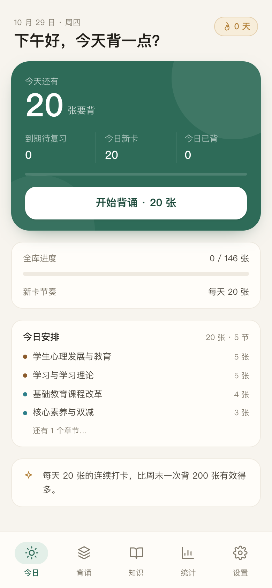
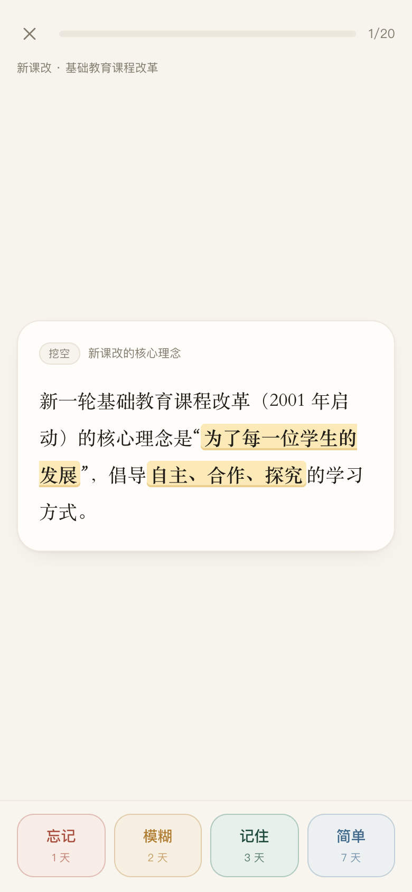
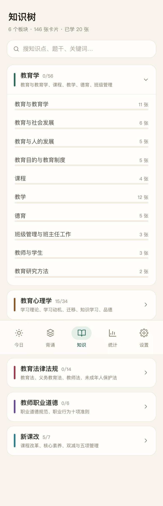
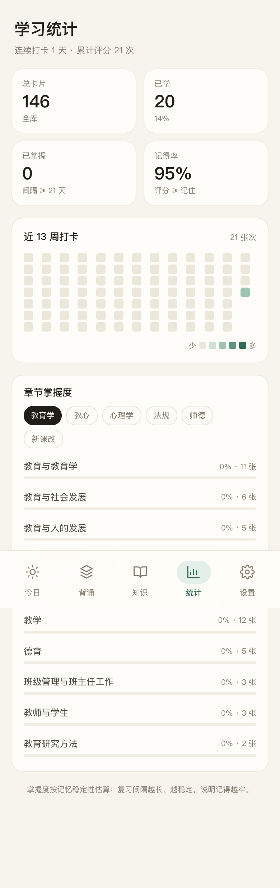

# 教基背诵 · 教育基础知识

教师招聘《教育基础知识》的间隔重复背诵工具。手机浏览器打开即可用，可添加到主屏离线背诵。

**核心思路**：把知识点拆成「能独立回忆的最小单元」，用主动回忆 + FSRS 间隔重复 + 挖空/口诀/易混辨析把它焊进长期记忆。

> **在线使用**：<https://zjminc.github.io/recite-app/>
>
> [](https://github.com/ZJMinc/recite-app/actions/workflows/deploy.yml)

## 界面

| 今日 | 背诵 |
|---|---|
|  |  |

| 知识树 | 统计 |
|---|---|
|  |  |

## 快速开始

```bash
pnpm install
pnpm dev        # 本地开发 http://localhost:5173
pnpm build      # 产出 dist/
pnpm preview    # 预览生产构建
```

纯静态站点，`dist/` 丢到任意静态托管（Vercel / Netlify / Cloudflare Pages）即可，无需后端。路由用 hash（`/#/stats`），不需要服务器 rewrite 配置。

## 多端同步（可选）

默认纯本地，不需要任何服务器。想让手机、电脑共用一份进度，可以接一个自建后端：

- **设计取舍** → [`docs/SYNC.md`](docs/SYNC.md)
- **首次部署**（PocketBase + Tailscale，飞牛OS 为例） → [`deploy/README.md`](deploy/README.md)
- **备份 / 还原 / 排障 / 升级** → [`docs/OPS.md`](docs/OPS.md)

开启方式：App 里 **设置 → 多端同步** 填地址、邮箱、密码即可。

两个前提条件：后端必须有 **HTTPS**（PWA 的 Service Worker 只在安全上下文注册），
且客户端能访问到它。Tailscale 组网可以同时满足这两点，不需要公网 IP、不用动路由器端口映射。

同步的语义很简单：复习日志只追加，所以**取并集**即可无冲突合并；每张卡的 FSRS 状态
按 `last_review` 做 last-write-wins；当日统计从日志重算。**离线仍是真相源**，
后端只是合并点，挂了也能照常背。

## 已实现

| 模块 | 说明 |
|---|---|
| 今日 | 待复习/新卡统计、连续打卡、全库进度、考试倒计时、今日章节安排 |
| 背诵 | 一屏一卡，主动回忆 → 翻面 → 四档自评（忘记/模糊/记住/简单）；答错自动重新入队；键盘 空格 + 1~4 |
| 算法 | FSRS（ts-fsrs），按目标记忆率 85/90/95% 调度，四档按钮实时显示「下次间隔」 |
| 题型 | 挖空（`{{答案}}`）、问答、单选、判断；支持解析、口诀、易混提醒 |
| 知识树 | 6 大板块 / 46 个章节 / 1358 张卡片，按章节展示掌握度，支持全文搜索与卡片详情 |
| 统计 | 近 13 周打卡热力图、记得率、章节掌握度 |
| 设置 | 每日新卡量、考试日期、目标记忆率、JSON 备份导入导出、重置进度 |
| PWA | 离线可用、可安装到桌面/主屏、图标齐全 |
| 刷题 | 按章节组卷（选择/判断）、即时判分 + 解析/口诀/易混提示、键盘 1–9 作答 |
| 错题本 | 答错自动收录、按错误次数排序、连对 2 次自动移出、可一键重练 |
| 简答默写 | 不看答案手写要点，自动拆分采分点并按字符覆盖率打分，可一键采纳建议评分 |
| 学习计划 | 按考试日期倒推每天需要的新卡量，跟不上时提示调高每日新卡 |
| 暗色模式 | 跟随系统 / 强制浅色 / 强制深色，配色变量整体切换 |
| 听背 TTS | 进入新卡自动读题、手动朗读答案与解析，通勤可不看屏幕 |

数据全部存在浏览器 IndexedDB（库名 `jiaojibei`），不上传任何服务器。

## 内容怎么加

所有卡片在 [`src/data/seed.ts`](src/data/seed.ts)，章节树在 [`src/data/curriculum.ts`](src/data/curriculum.ts)。

批量导入（JSON → 校验 → 追加）与质量闸门的完整说明见 [`docs/CONTENT.md`](docs/CONTENT.md)。

```ts
{
  id: 'p6-11',              // 唯一 id，按「章节-序号」命名
  subjectId: 'pedagogy',    // pedagogy | psychology | edupsy | law | ethics | newcur
  chapterId: 'p6',          // 对应 curriculum.ts 里的章节
  kp: '教学原则',            // 知识点名称（卡片标题）
  type: 'cloze',            // cloze | qa | choice | judge
  front: '',                // 挖空卡的提示语，可留空
  back: '启发性原则要求调动学生学习的{{主动性}}。',  // 挖空处用 {{}}
  mnemonic: '直启循巩，因理科量',   // 可选：口诀
  confusables: '…',         // 可选：易混提醒
  analysis: '…',            // 可选：解析
  importance: 5,            // 1~5，决定新卡优先顺序
}
```

写卡原则：

1. **一张卡只考一个点**，超过 3 个要点就拆开；
2. 挖空只挖「关键词」，不要整句挖空；
3. 能编口诀的尽量编，口诀是最省力的记忆钩子；
4. 易混的成对概念，用 `confusables` 明确写出区别。

加卡后刷新页面即可，`initDB()` 会按 id 补齐缺失卡片，**不会覆盖已有学习进度**。

## 目录

```
src/
├─ data/          curriculum.ts 章节树；cards/<科目>.ts 卡片内容（按需动态加载）
├─ pages/         Today / Review / Browse / Stats / Settings
├─ components/    Layout、CardBody、RatingBar、Icon
├─ lib/           stats.ts 统计与掌握度计算
├─ store/         settings.ts（zustand + localStorage）
├─ sync/          多端同步（可选）：merge 纯合并规则 / client / engine / useSync
├─ db.ts          Dexie 表结构、评审事务、备份重置
├─ scheduler.ts   FSRS 封装（评分、间隔预览）
└─ types.ts       数据模型
scripts/          端到端冒烟测试（playwright）+ 同步合并测试
pb_migrations/    PocketBase 集合定义（仅当你自建后端时需要）
deploy/           docker-compose 与部署步骤
docs/             规划、（同步）设计与运维手册
```

## 测试

```bash
pnpm preview --port 4173 &     # 先起预览服务
node scripts/smoke.mjs         # 首页 → 背 20 张 → 各页面截图
node scripts/flow.mjs          # 到期复习、选择题、离线
node scripts/backup.mjs        # 导出 / 重置 / 导入
```

## 路线图

- [x] M1 背诵闭环（FSRS + 挖空 + 统计 + 本地存储 + PWA）
- [ ] M2 刷题模式：按章节组卷、错题本、连对移出
- [ ] M3 输出式记忆：简答默写、要点覆盖率打分、学习计划倒推
- [ ] M4 打磨：暗色模式、TTS 听背、内容批量导入
- [ ] M5 扩内容：目标 1500–3000 张

## License

[MIT](LICENSE) © ZJMinc
